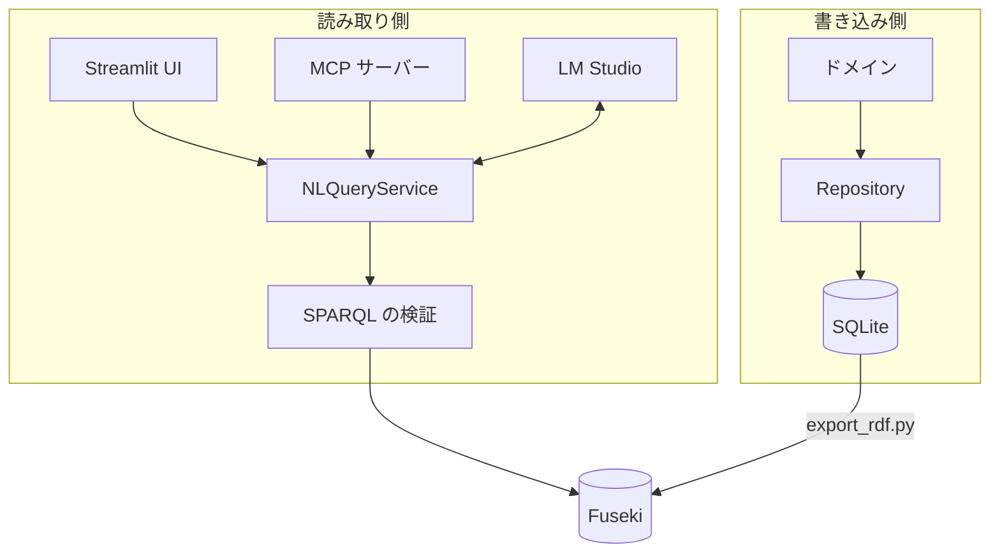

catcafe は、書き込み側と読み取り側を分けています。SQLite が正のデータで、Fuseki はそこから作る読み取り専用の投影です。

## 全体像

## レイヤー

パッケージは `src/catcafe/` の下にあります。

| レイヤー | パッケージ | 役割 |
| --- | --- | --- |
| ドメイン | `domain/` | エンティティと値オブジェクトを定義します。外部依存はありません。 |
| 永続化 | `persistence/` | Repository Protocol、フェイク実装、SQLAlchemy 実装、ORM との変換を持ちます。 |
| セマンティック | `semantic/` | RDF への変換、SPARQL の実行と検証、自然言語検索を担当します。 |

ファイルの配置は次のとおりです。

<Tree>
  <Tree.Folder name="src/catcafe" defaultOpen>
    <Tree.Folder name="domain" defaultOpen>
      <Tree.File name="_base.py" />
      <Tree.File name="value_objects.py" />
      <Tree.File name="reservation.py" />
      <Tree.File name="order.py" />
    </Tree.Folder>
    <Tree.Folder name="persistence" defaultOpen>
      <Tree.File name="mappers.py" />
      <Tree.File name="orm_models.py" />
      <Tree.Folder name="repositories" defaultOpen>
        <Tree.File name="protocols.py" highlight />
        <Tree.File name="fakes.py" />
        <Tree.File name="sqlalchemy_repositories.py" />
      </Tree.Folder>
    </Tree.Folder>
    <Tree.Folder name="semantic" defaultOpen>
      <Tree.Folder name="nl_query" defaultOpen>
        <Tree.File name="prompt.py" />
        <Tree.File name="service.py" highlight />
        <Tree.File name="llm_client.py" />
      </Tree.Folder>
      <Tree.Folder name="rdf" defaultOpen>
        <Tree.File name="rdf_mapper.py" />
        <Tree.File name="sparql_validation.py" highlight />
        <Tree.File name="http_fuseki_client.py" />
        <Tree.File name="fakes.py" />
      </Tree.Folder>
    </Tree.Folder>
  </Tree.Folder>
</Tree>

## 設計の要点

<AccordionGroup>
  <Accordion title="SQLite を正とし、RDF は一方向の投影にする" icon="arrow-right" defaultOpen>
    `scripts/export_rdf.py` が Repository 経由で全エンティティを読み、RDF に変換します。Fuseki から SQLite へ書き戻す経路はありません。
  </Accordion>
  <Accordion title="Protocol で実装を差し替えられるようにする" icon="plug">
    Repository と `FusekiClient` は `typing.Protocol` で定義しています。テストでは DB や Docker を使わないフェイクに差し替えられます。
  </Accordion>
  <Accordion title="自然言語からクエリへの変換を 1 経路に絞る" icon="route">
    Streamlit UI と MCP サーバーは、どちらも `NLQueryService` だけを呼びます。MCP クライアントがクエリを直接組み立てるツールは、意図的に公開していません。
  </Accordion>
  <Accordion title="同期処理を選ぶ" icon="clock">
    永続化層は同期版の SQLAlchemy を使います。設計時点ではサーバーがなく、非同期化の恩恵がないと判断しました。
  </Accordion>
</AccordionGroup>

## 次に読むページ

<Columns cols={2}>
  <Card title="ドメインモデル" icon="cat" href="/concepts/domain-model">
    エンティティと状態遷移を確認します。
  </Card>
  <Card title="自然言語検索の仕組み" icon="wand-magic-sparkles" href="/concepts/nl-query">
    質問が SPARQL になるまでの流れを確認します。
  </Card>
</Columns>
