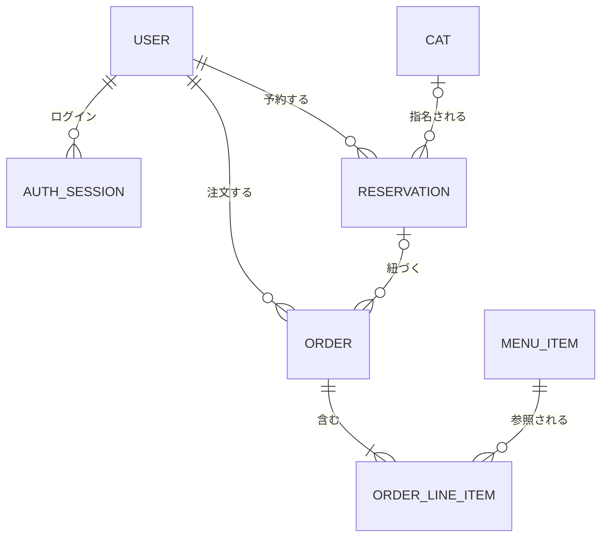
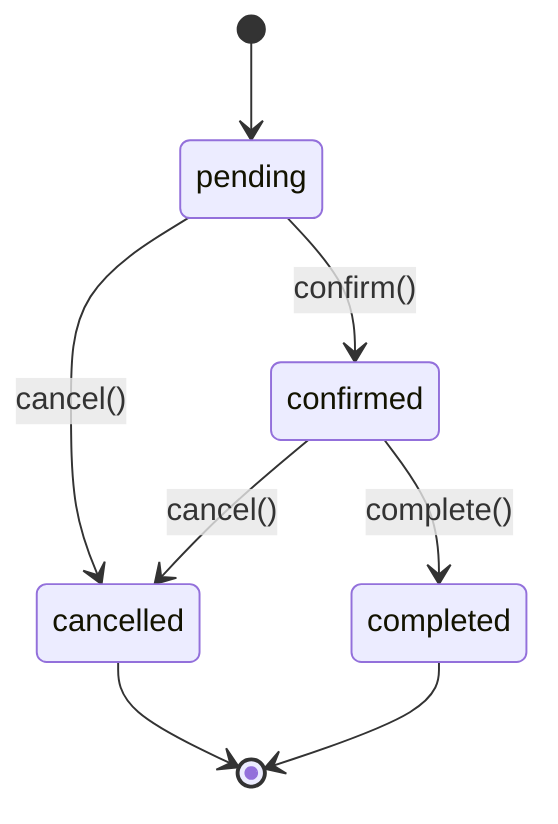
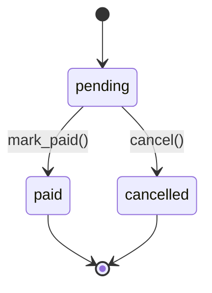

import { ReservationStateExplorer } from "/snippets/reservation-state-explorer.jsx";

ドメイン層には `User`、`AuthSession`、`Cat`、`Reservation`、`MenuItem`、`Order`、`OrderLineItem` の 7 エンティティがあります。すべて `Entity` を継承した、変更できない Pydantic モデルです。

## エンティティの関係



各フィールドは[エンティティリファレンス](/reference/entities)で確認できます。

## 不変条件を迂回させない

状態を変えるメソッドは、元のインスタンスを変更せず、新しいインスタンスを返します。内部の `_replace()` が変更後の値を必ず再検証するため、不変条件を破る更新はできません。

```python src/catcafe/domain/_base.py wrap highlight={4}
class Entity(BaseModel):
    model_config = ConfigDict(frozen=True)

    def _replace(self, **changes: Any) -> "Entity":
        return type(self).model_validate({**self.model_dump(mode="python"), **changes})
```

コードが保証する主な不変条件は次のとおりです。

| エンティティ | 不変条件 |
| --- | --- |
| `AuthSession` | `expires_at` は `created_at` より後です。 |
| `Reservation` | `end_time` は `start_time` より後です。 |
| `Order` | `line_items` は 1 件以上で、`total_amount` は明細の合計と一致します。 |

## 値オブジェクト

Rust の newtype に近い考え方で、検証済みの型を定義しています。

| 型 | ルール |
| --- | --- |
| `NonEmptyStr` | 前後の空白を除いて 1 文字以上です。 |
| `EmailAddress` | `xxx@yyy.zzz` の形です。 |
| `Yen` | 0 以上の整数です。小数と外貨は扱いません。 |
| `PartySize` | 1 以上の整数です。 |
| `Quantity` | 1 以上の整数です。 |

`UserId` や `CatId` などの ID は `NewType(UUID)` で定義しています。型チェッカーを使うと、エンティティ間で ID を取り違えたときに検出できます。

## 予約の状態遷移



許可されていない遷移は `ValueError` になります。次のボタンで試せます。

<ReservationStateExplorer />

## 注文の状態遷移

注文は `pending` からのみ遷移します。



## 認証セッション

`AuthSession` は生の SSO トークンを保持せず、`token_hash` だけを保存します。`is_active_at(now)` は、失効しておらず期限内であれば `True` を返します。`revoke(at)` を 2 回呼ぶと `ValueError` になります。

<Note>
  ドメイン層の日時は常に UTC である前提です。SQLite はタイムゾーン付きの日時を保持しないため、UTC の naive datetime として保存し、読み出すときに UTC を復元します。
</Note>
