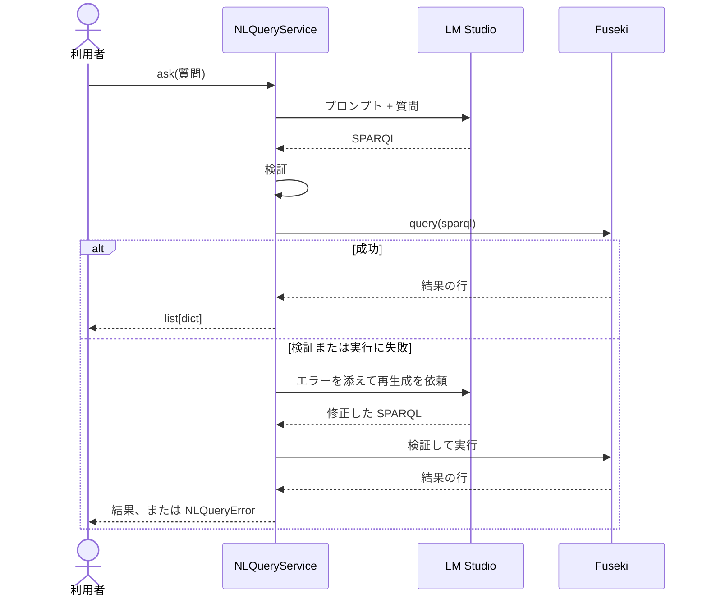

`NLQueryService.ask()` は、質問を受け取り、クエリの実行結果の行を返します。LLM に結果を要約させることはありません。

## 処理の流れ

## リトライの範囲

リトライは 1 回だけです。対象は `RdfSemanticLayerError` の系統、つまり SPARQL の検証エラーと Fuseki のクエリエラーです。

LM Studio への接続エラーなど、それ以外の例外はリトライせずにそのまま送出します。

## システムプロンプトの工夫

`prompt.py` のシステムプロンプトは、オントロジーの説明、ルール、5 つの few-shot 例でできています。SPARQL は SQL よりも小型モデルの学習データに少ないため、例を重視しています。

<Tabs>
  <Tab title="ルール">
    - 必ず `PREFIX cc:` を宣言します。
    - `SELECT` クエリだけを書きます。
    - 省略可能な関係は `OPTIONAL` で囲みます。
    - 集計には `GROUP BY` と集約関数を使います。
    - コードフェンスや説明を付けず、クエリを 1 つだけ返します。
    - マスキングには `STRBEFORE` や `STRAFTER` ではなく `REPLACE` を使います。
    - 質問が複数の要素を含むときは、1 つのクエリですべてに答えます。
  </Tab>
  <Tab title="few-shot 例">
    1. ステータス別の予約数
    2. 注文ステータス別の売上合計
    3. 猫の指名有無別の予約数（`OPTIONAL` と `BIND(BOUND(...))`）
    4. 予約と注文をまたぐ集計
    5. 表示名の姓のマスキング

    同じクエリを [SPARQL レシピ](/guides/sparql-recipes)に掲載しています。
  </Tab>
</Tabs>

LLM がプロンプトに従わずコードフェンスを付けた場合も、`_strip_markdown_fence()` が取り除きます。

## 設計時の判断

| 判断 | 理由 |
| --- | --- |
| LLM に生の SPARQL を生成させる | 以前の JSON 構造化クエリ方式を廃止し、SPARQL に一本化しました。 |
| 結果を要約しない | クエリの実行結果の行をそのまま返します。 |
| ローカル LLM を既定にする | 既定の接続先は LM Studio の `http://localhost:1234/v1` です。 |

設計ドキュメントには、LM Studio と `google/gemma-4-e4b` での動作確認が記録されています。その確認では、1 回目の応答で構文の正しい SPARQL が得られ、リトライは発生しませんでした。

<Card title="別の LLM を使う" icon="plug" href="/guides/custom-llm" horizontal>
  `LLMClient` Protocol を実装して差し替えます。
</Card>
