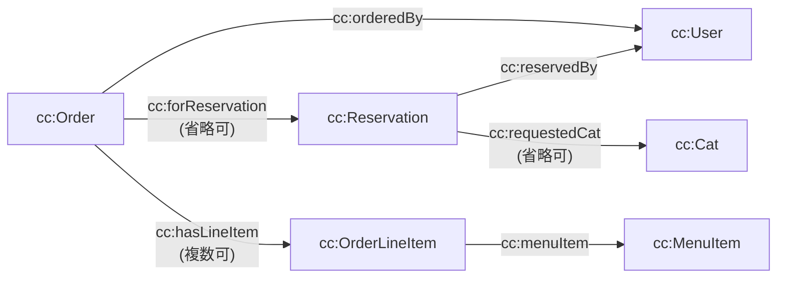

セマンティック層は、ドメインエンティティを <Tooltip tip="「主語・述語・目的語」の 3 つ組でデータを保持するデータベースです。">RDF トリプルストア</Tooltip>に投影し、SPARQL で検索できるようにします。

## オントロジーの概要

名前空間は `cc: <http://catcafe.example/onto#>` です。リソース URI は `http://catcafe.example/resource/<kind>/<uuid>` の形式です。

プロパティの一覧は[オントロジーリファレンス](/reference/ontology)にあります。

## RDF に含まれないデータ

`rdf_mapper.py` が投影するのは、検索に必要な項目だけです。次の項目は Fuseki に入りません。

- `AuthSession` エンティティ全体
- `User` の `sso_subject`、`created_at`、`updated_at`
- `Cat` の `profile_description`、`photo_url`
- `Reservation` の `notes`、`created_at`、`updated_at`
- `MenuItem` の `description`

<Warning>
  `cc:displayName` と `cc:email` は Fuseki に入ります。個人情報の扱いは[セキュリティの前提](/project/security)を確認してください。
</Warning>

## なぜブランクノードを使わないのか

すべてのリソースに URI を割り当てています。rdflib と Fuseki の間で、ブランクノードの扱いが食い違う問題を避けるためです。

## クエリの実行先を差し替える

`FusekiClient` Protocol のメソッドは `query(sparql)` だけです。実装は 2 つあります。

<Columns cols={2}>
  <Card title="HttpFusekiClient" icon="server">
    稼働中の Fuseki に HTTP で問い合わせます。
  </Card>
  <Card title="InMemoryFusekiClient" icon="memory">
    `rdflib.Graph` に対して実行します。Docker は不要です。
  </Card>
</Columns>

<Info>
  rdflib のインメモリエンジンは、射影したすべての変数が未束縛の行を落とします。SPARQL の仕様上は結果に含まれるべき行です。`OPTIONAL` の外側の変数も射影に含めると回避できます。
</Info>

## SELECT だけを通す

LLM が生成したクエリは、Fuseki に送る前に `validate_select_query()` で検証します。

1. rdflib の `prepareQuery()` でパースします。`INSERT` や `DELETE` は Query 文法にないため、ここで失敗します。
2. 代数の種類が `SelectQuery` であることを確かめます。`ASK`、`CONSTRUCT`、`DESCRIBE` はここで拒否します。

設計ドキュメントによると、Fuseki のクエリエンドポイントも UPDATE 文を受け付けないため、二重の防御になります。
