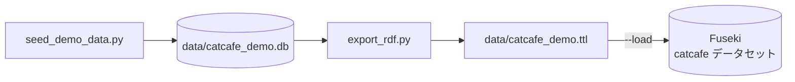

デモデータは 2 つのスクリプトで準備します。



## データを生成する

```bash
python scripts/seed_demo_data.py
```

既定では、過去 365 日分のデータを `data/catcafe_demo.db` に生成します。`data/` は Git の管理対象外です。

<Warning>
  同じパスにファイルがあると、スクリプトはそのファイルを削除して作り直します。
</Warning>

## データの特徴

クエリの結果を解釈するときは、次の特徴に注意します。

| 項目 | 内容 |
| --- | --- |
| 予約のステータス | `completed` が約 85%、`cancelled` が約 15% です。`pending` と `confirmed` はありません。 |
| 注文のステータス | `paid` が約 95%、`cancelled` が約 5% です。`pending` はありません。 |
| 予約枠 | 毎日 11 時から 18 時台までの 1 時間枠で、各枠 0 から 4 件です。 |
| 猫の指名 | 予約の約半数です。 |
| SSO プロバイダー | `google`、`line`、`apple` です。 |
| 人気商品 | `ちゅーる` と `またたびボール` が選ばれやすくなっています。 |

<Note>
  `--seed` を固定しても、完全には再現されません。ID には `uuid4()` を使い、日付は実行時刻を基準にするためです。
</Note>

## RDF に変換してロードする

<Steps>
  <Step title="Fuseki を起動する">
    ```bash
    docker compose up -d fuseki
    ```
  </Step>
  <Step title="変換してロードする">
    ```bash
    python scripts/export_rdf.py --load
    ```

    データセットがなければ作成します。その後、Turtle ファイルをデフォルトグラフに `PUT` します。
  </Step>
</Steps>

`--load` には `httpx` が必要です。`ui`、`mcp`、`nlquery` のいずれかの extra でインストールされます。

<Warning>
  `export_rdf.py` は `FUSEKI_ADMIN_PASSWORD` を読みません。パスワードを変更して Fuseki を起動したときは、`--fuseki-admin-password` で同じ値を渡します。
</Warning>

## データの規模

設計ドキュメントには、次の実測値が記録されています。

<Columns cols={3}>
  <Card title="107,231" icon="circle-nodes">トリプル</Card>
  <Card title="約 5,900" icon="calendar-check">予約</Card>
  <Card title="約 3,300" icon="receipt">注文</Card>
</Columns>

猫は 30 匹、メニューは 50 品、ユーザーは 100 人です。SQLite から Turtle への書き出しは約 7 秒で、Fuseki へのロードを含めても約 10 秒でした。

スクリプトのオプションは[スクリプトリファレンス](/reference/scripts)にあります。
