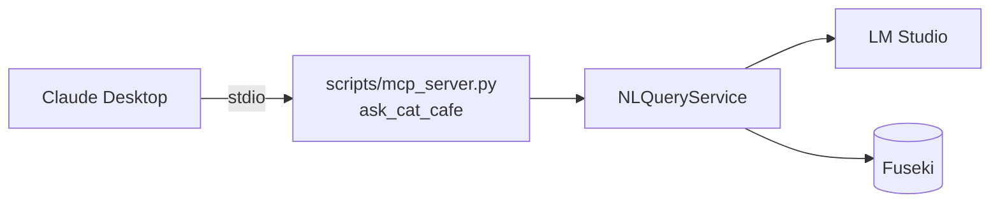

MCP サーバーが公開するツールは `ask_cat_cafe(question)` の 1 つだけです。内部では `NLQueryService` を呼びます。



<Note>
  SPARQL を生成するのは Claude ではなく、LM Studio のモデルです。Claude はツールに質問を渡し、結果の行を受け取ります。
</Note>

## 設定する

以下は Windows の手順です。

<Steps>
  <Step title="依存パッケージをインストールする">
    ```powershell
    uv pip install -e ".[mcp]"
    ```
  </Step>
  <Step title="設定ファイルを開く">
    `%APPDATA%\Claude\claude_desktop_config.json` を開きます。ファイルがなければ新規に作成します。
  </Step>
  <Step title="サーバーを登録する">
    `mcpServers` に次の内容を追加します。パスは、あなたのリポジトリの絶対パスに置き換えます。

    ```json claude_desktop_config.json highlight={4,5}
    {
      "mcpServers": {
        "catcafe-nlquery": {
          "command": "C:\\dev\\claude\\catcafe\\.venv\\Scripts\\python.exe",
          "args": ["C:\\dev\\claude\\catcafe\\scripts\\mcp_server.py"],
          "env": {
            "FUSEKI_BASE_URL": "http://localhost:3030",
            "FUSEKI_DATASET": "catcafe",
            "LMSTUDIO_MODEL": "google/gemma-4-e4b",
            "LMSTUDIO_BASE_URL": "http://localhost:1234/v1"
          }
        }
      }
    }
    ```

    <Warning>
      `command` には venv の `python.exe` を直接指定します。サブプロセスはシェルの環境を引き継がないためです。
    </Warning>
  </Step>
  <Step title="Claude Desktop を再起動する">
    Claude Desktop を完全に終了してから、起動し直します。設定のリロードでは反映されません。
  </Step>
  <Step title="Fuseki と LM Studio を起動する">
    Fuseki を起動し、LM Studio にモデルをロードします。データが未ロードなら、先に次のコマンドを実行します。

    ```powershell
    python scripts/export_rdf.py --load
    ```
  </Step>
  <Step title="会話で質問する">
    ツールが利用可能になっていることを確認し、「猫カフェの予約状況を教えて」のように質問します。
  </Step>
</Steps>

## 動かないときは

Claude Desktop は、MCP サーバーの標準エラー出力を次のファイルに書き出します。まずこのログを確認します。

```text
%APPDATA%\Claude\logs\mcp-server-catcafe-nlquery.log
```

サーバーを手動で起動して確認することもできます。

```powershell
.venv\Scripts\python.exe scripts\mcp_server.py
```

エラーなく待機状態になれば正常です。Ctrl+C で終了します。

## サーバーを改造するときの注意

- **`print()` を使わないでください。** 標準出力は MCP の通信路です。ログは `logging` モジュールで標準エラー出力に書きます。
- **`mcp` は 2.0 以上が必要です。** 旧 `FastMCP` ではなく、`mcp.server.mcpserver` の `MCPServer` を使います。
- **ツールのロジックは `resolve_question()` に書きます。** MCP を介さずに関数としてテストできます。
- **ツール内の例外は握りつぶしません。** `NLQueryError` などは MCP SDK の標準動作でクライアントに伝わります。
