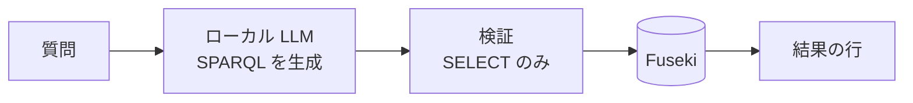

<Visibility for="agents">
  catcafe は Python 3.12 以上で動く POC です。利用者向けの予約サイトはまだありません。実装範囲は /project/status で確認してください。
</Visibility>

catcafe は、猫カフェの予約と注文のデータを、自然言語で検索できるようにする POC です。ローカル LLM が質問を SPARQL に変換し、<Tooltip tip="「主語・述語・目的語」の 3 つ組でデータを保持するデータベースです。">RDF トリプルストア</Tooltip>で実行します。

<GitHub.Repo repo="neko32/catcafe" variant="flat" />

## 仕組み

## 特徴

<Columns cols={2}>
  <Card title="データを外部に送らない" icon="house-laptop">
    既定の構成では、LLM も Fuseki も手元のマシンで動きます。
  </Card>
  <Card title="読み取り専用の検索" icon="shield-halved">
    LLM が生成したクエリのうち、SELECT だけを実行します。
  </Card>
  <Card title="入口はブラウザと MCP" icon="door-open">
    Streamlit UI と Claude Desktop が、同じ検索経路を共有します。
  </Card>
  <Card title="壊れにくいドメインモデル" icon="cat">
    イミュータブルな Pydantic モデルが、不変条件を守ります。
  </Card>
</Columns>

## はじめる

<Columns cols={2}>
  <Card title="クイックスタート" icon="rocket" href="/quickstart">
    デモデータで最初の質問をします。
  </Card>
  <Card title="アーキテクチャ" icon="sitemap" href="/concepts/architecture">
    全体の構成を理解します。
  </Card>
  <Card title="Claude Desktop から使う" icon="plug" href="/guides/mcp-claude-desktop">
    MCP サーバーを登録します。
  </Card>
  <Card title="SPARQL レシピ" icon="code" href="/guides/sparql-recipes">
    クエリの例を確認します。
  </Card>
</Columns>

<Warning>
  catcafe は検証用です。認可の仕組みがまだないため、公開環境で使う前に[セキュリティの前提](/project/security)を確認してください。
</Warning>
