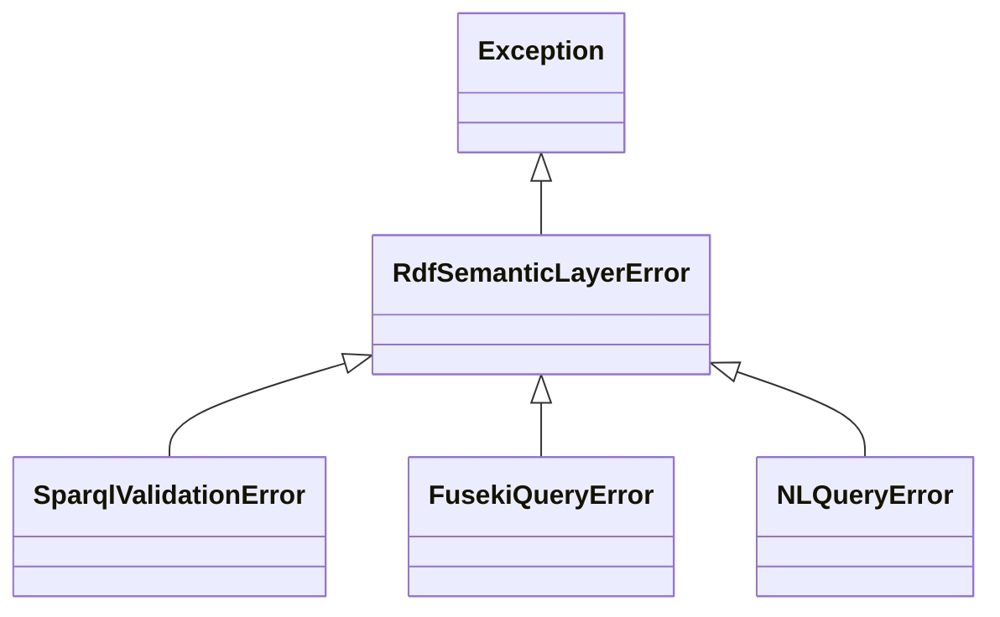

## FusekiClient

読み取り専用の SPARQL を実行する先の Protocol です。

```python
class FusekiClient(Protocol):
    def query(self, sparql: str) -> list[dict[str, Any]]: ...
```

## HttpFusekiClient

`POST /<dataset>/sparql` で Fuseki に問い合わせます。モジュール: `catcafe.semantic.rdf.http_fuseki_client`

<ResponseField name="base_url" type="str" required>
  Fuseki のベース URL です。
</ResponseField>

<ResponseField name="dataset" type="str" required>
  データセット名です。
</ResponseField>

<ResponseField name="timeout" type="float" default="30.0">
  HTTP のタイムアウト秒数です。
</ResponseField>

`httpx` は `query()` の中で import します。HTTP エラーは `FusekiQueryError` になります。

<Warning>
  `query()` は `validate_select_query()` を呼びません。検証を行うのは `NLQueryService` です。また、認証情報も送りません。
</Warning>

### 型の変換

結果の値は次の Python 型になります。未束縛の変数は `None` です。

| RDF | Python |
| --- | --- |
| URI、ブランクノード | `str` |
| `xsd:integer` | `int` |
| `xsd:decimal` | `Decimal` |
| `xsd:double`、`xsd:float` | `float` |
| `xsd:boolean` | `bool` |
| `xsd:dateTime` | `datetime` |
| その他 | `str` |

## InMemoryFusekiClient

`rdflib.Graph` に対してクエリを実行するフェイクです。Docker は不要です。モジュール: `catcafe.semantic.rdf.fakes`

<ResponseField name="graph" type="rdflib.Graph" required>
  クエリの対象のグラフです。
</ResponseField>

## validate_select_query

SPARQL が SELECT クエリであることを、ネットワークを使わずに検証します。モジュール: `catcafe.semantic.rdf.sparql_validation`

```python
validate_select_query(sparql: str) -> None
```

パースに失敗したとき、または SELECT 以外のときは `SparqlValidationError` を送出します。

## 例外



| 例外 | 発生する場面 |
| --- | --- |
| `SparqlValidationError` | SPARQL の検証に失敗しました。 |
| `FusekiQueryError` | クエリの実行または HTTP 通信に失敗しました。 |
| `NLQueryError` | `NLQueryService` がリトライ後も解決できませんでした。 |
